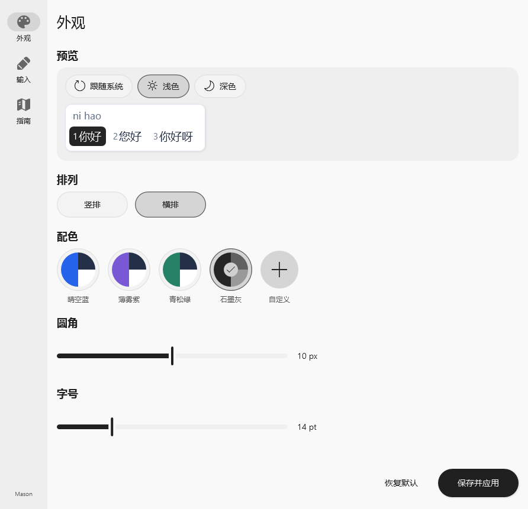
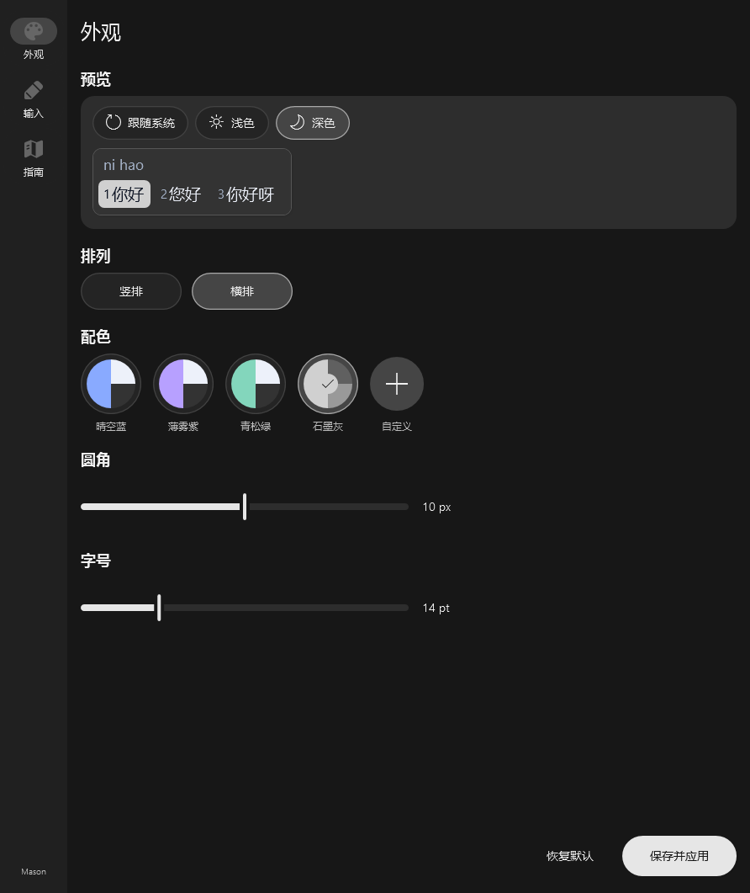
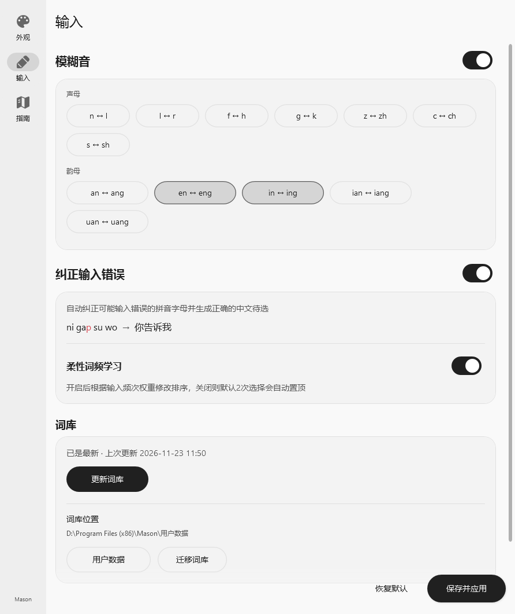
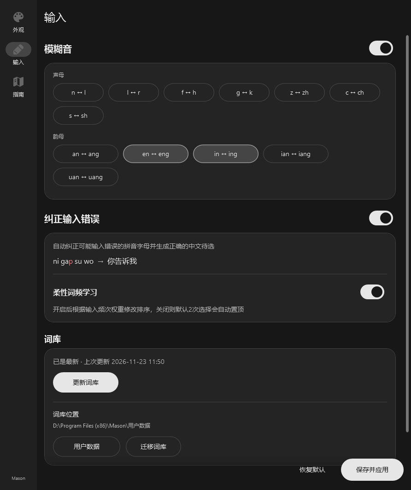
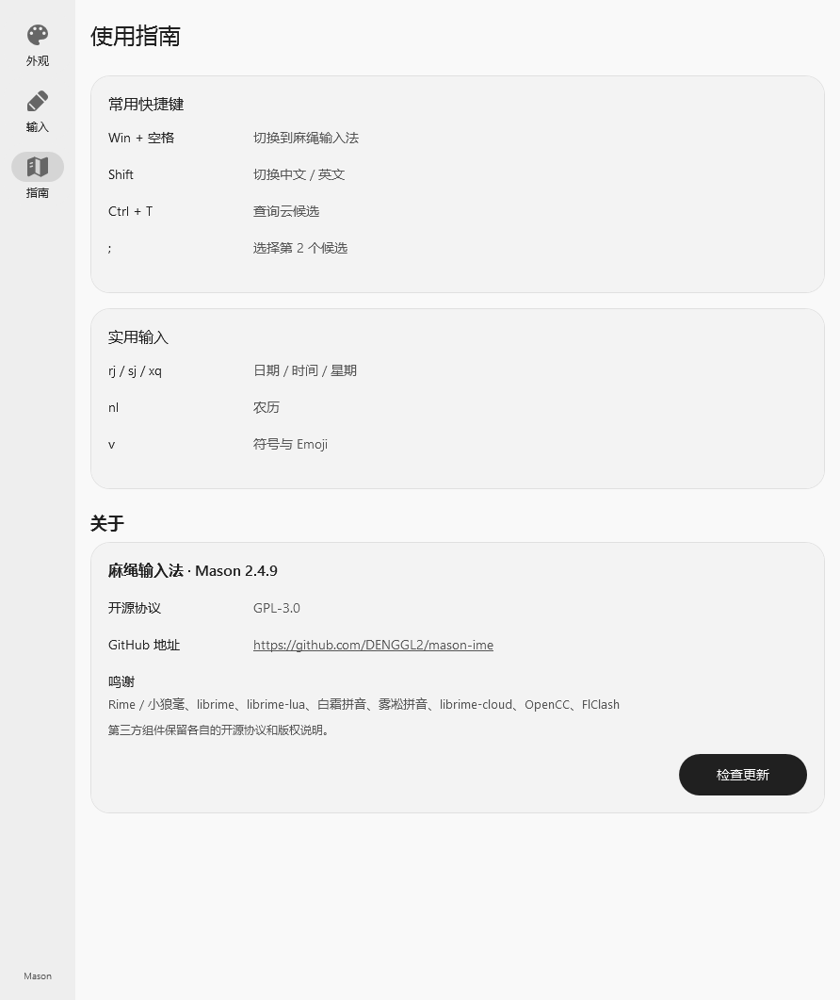
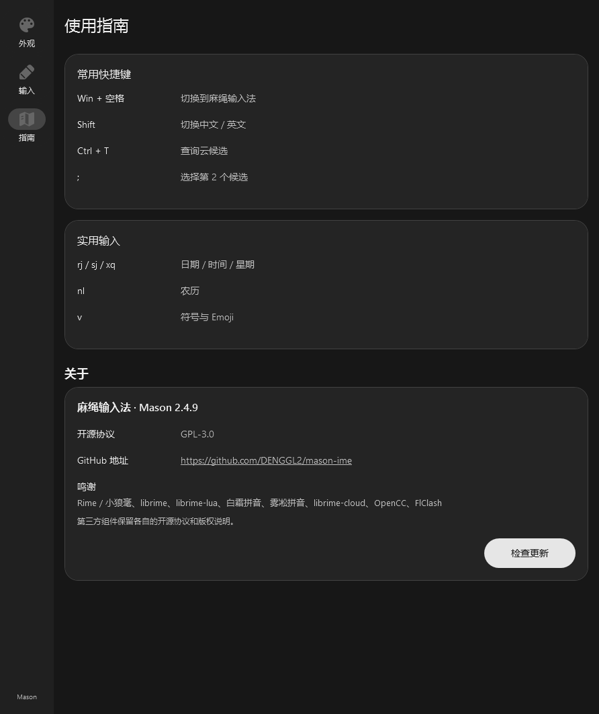
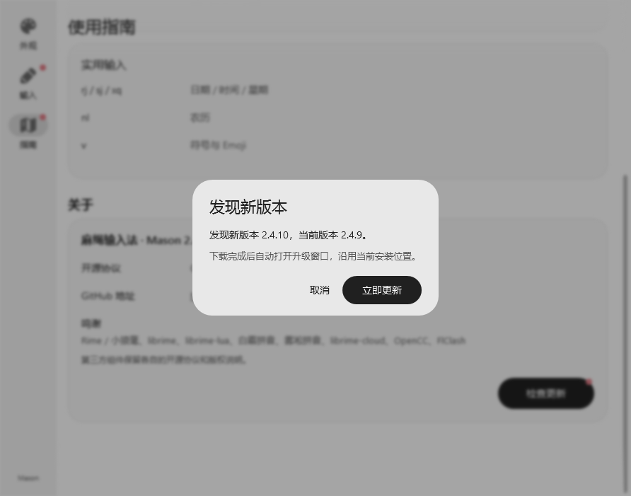
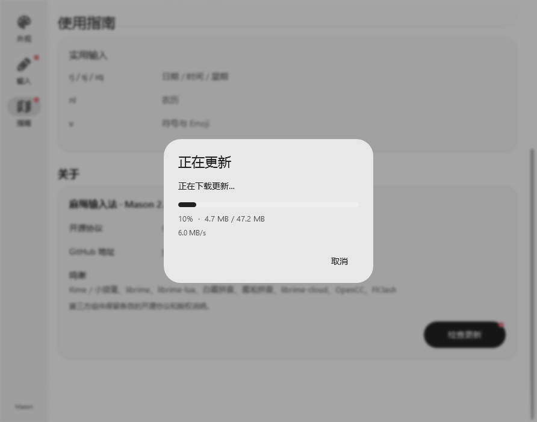

# 麻绳输入法 · Mason

面向 Windows 的拼音输入法，在 **Rime / 小狼毫** 引擎和 **白霜拼音** 方案上定制，加入现代设置界面、图形安装器和精简的系统菜单。

[下载最新版本](https://github.com/DENGGL2/mason-ime/releases/latest) · [使用说明](使用说明.md) · [源码构建](docs/BUILDING.md)

## 功能与特点

- **拼音输入**：完整本地词库、个人词条学习、简繁切换、12 组可选模糊音；支持云候选、日期时间、农历、符号和 Emoji。
- **输入纠错**：本地识别相邻键的字母误按，优先生成对应中文候选；保留原始拼音，只把疑似错误的字母标红，可在输入页关闭。当前处理一次字母替换，合法全拼、简拼和混合拼音优先保留原候选。
- **选词习惯**：输入页提供“柔性词频学习”。默认关闭时，同一编码主动选择同一词两次后置顶；开启时按词频权重调整排序。记录只保存在本机，切换模式后继续保留。
- **外观自定义**：浅色、深色和跟随系统，横排 / 竖排、预设与自定义配色、圆角、字号，候选窗实时预览。
- **现代界面**：WPF 矢量绘制，统一圆角控件与平滑动效；设置分为外观、输入、指南，保持单窗口。
- **候选动效与响应**：候选窗与新增拼音使用轻量弹出动效；中文、英文和 Emoji 候选仅渐显。优化首个字母的显示速度，保存设置后静默应用。
- **系统集成**：M 标识，原生菜单提供中 / 英、简 / 繁、半 / 全角、翻译开关、设置、更新词库、检查更新。
- **安装与更新**：图形安装，自动识别已有安装路径；程序更新在设置窗口内下载，显示进度和网速，校验后自动打开覆盖升级窗口；词库一键更新，网络中断可重试。
- **更新提醒**：每个程序或词库新版只通知一次，点击打开对应设置位置；导航、按钮及原有输入法栏菜单用低饱和度红点提示。右键查看后清除图标红点，页面和菜单红点保留到更新完成。
- **目录清晰**：程序、用户数据、日志、备份集中在安装目录；运行安装包保留完整词库和云输入，开发文件单独保留在源码仓库。

## 安装

1. 从 [Releases](https://github.com/DENGGL2/mason-ime/releases/latest) 下载 `Mason-2.4.9-Windows.zip`，完整解压。
2. 运行文件夹内的 `Mason.Install.exe`，选择安装地址并开始安装。已有 Mason 会沿用原路径进行覆盖更新。
3. 用 `Win + 空格` 切换输入法，从系统输入法右键菜单打开设置。

使用环境：**Windows 10 / 11、.NET Framework 4.8、Python 3.10 或更新版本**。设置后端使用 Python 标准库；运行包不内置 Python。引擎优先从包内安装，缺失时再联网下载。

2.4.9 起，“检查更新”发现新版会提供“立即更新”和“取消”，在窗口内完成下载和校验，再沿用现有路径覆盖升级。GitHub 匿名 API 额度用完时，自动读取官方发布页获取版本与校验值。详细流程、红点规则和验证说明见 [更新流程](docs/updates.md)。云候选和在线更新需要联网。

## 最新设置界面

以下为 Mason **2.4.9** 实际 WPF 界面的浅色 / 深色截图，展示外观、输入和指南页面；纠错开关、错误字母标红示例与柔性词频学习开关位于输入页。

| 页面 | 浅色 | 深色 |
| --- | --- | --- |
| 外观 |  |  |
| 输入 |  |  |
| 指南 |  |  |

## 更新流程效果

以下为隔离验证中的红点和窗口内更新流程，2.4.10 与词库 1.0.6 为模拟更新数据。真实运行会读取正式发布版本。

| 更新提示 | 窗口内下载 |
| --- | --- |
|  |  |

[查看红点和更新规则](docs/updates.md) · [浅色红点](docs/screenshots/updates/guide-badge-light.png) · [深色红点](docs/screenshots/updates/guide-badge-dark.png) · [词库更新红点](docs/screenshots/updates/dictionary-badge.png)

## 开源基础与鸣谢

| 项目 | 用途 |
| --- | --- |
| [Rime / 小狼毫](https://github.com/rime/weasel) · [librime](https://github.com/rime/librime) | Windows 输入引擎与系统集成 |
| [白霜拼音](https://github.com/gaboolic/rime-frost) · [雾凇拼音](https://github.com/iDvel/rime-ice) | 拼音方案、词库及其上游基础 |
| [librime-lua](https://github.com/hchunhui/librime-lua) | Lua 扩展支持 |
| [librime-cloud](https://github.com/hchunhui/librime-cloud) | 云候选与相关脚本 |
| [OpenCC](https://github.com/BYVoid/OpenCC) | 简繁和字形转换 |
| [WinSparkle](https://github.com/vslavik/winsparkle) | 上游引擎附带的更新组件 |
| [FlClash](https://github.com/chen08209/FlClash) | 界面布局与动效参考；Mason 前端使用 WPF 编写 |

Mason 新增的设置界面、安装器、原生菜单桥接、配置后端与 Lua 定制代码在本仓库提供。项目采用 **GPL-3.0**，第三方组件继续保留各自的协议与版权，详见 [LICENSE](LICENSE) 和 [THIRD_PARTY_NOTICES.md](THIRD_PARTY_NOTICES.md)。
